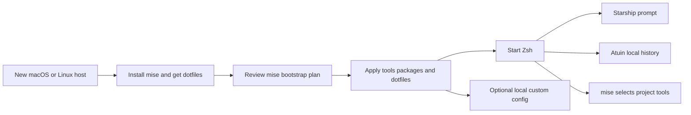

# Cross-platform dotfiles migration

Status: Apple Silicon macOS cutover is complete and verified. Fedora and
Debian/Ubuntu package configuration is in place; Linux runtime verification
remains pending because this host has no Linux VM/container runtime.

## Target

- Keep Zsh on macOS and Linux.
- Use mise for tool versions, package/bootstrap declarations, and dotfile links.
- Use Starship for the prompt.
- Use Atuin for local shell history and search. No account, sync, or server setup.
- Remove Oh My Zsh and Powerlevel10k after the replacement shell works.
- Keep shared config in `~/.dotfiles`; keep host-only settings in
  `~/.dotfiles-custom`.
- Give each tool, package, and dotfile one owner.



## Proposed layout

```text
~/.dotfiles/
├── mise.toml                     # tools, packages, dotfile mapping, tasks
├── shell/
│   ├── .zshenv                   # optional machine environment include
│   ├── .zshrc                    # small interactive entry point
│   ├── .aliases
│   ├── .functions
│   └── .exports                  # keep only portable shell environment
├── .config/
│   ├── starship.toml
│   └── atuin/config.toml         # local history settings only
└── shell/git/
    ├── .gitconfig
    ├── .gitconfig-patrium
    └── .global-gitignore

~/.dotfiles-custom/               # local-only; not currently a Git repo
└── shell/
    ├── local.env.zsh             # machine variables for all Zsh shells
    └── local.zsh                 # host paths and private aliases, if needed
```

Mise will materialize the shared files at their normal home paths. The custom
file stays optional and is sourced only when present. Keep machine credentials
and private values out of the shared repo.

## Audit notes

- `shell/.zshrc` mixes OMZ, Powerlevel10k, shell files, SDKMAN wrappers, and
  app-specific PATH setup. It duplicates the OpenCode path and hardcodes both
  macOS and Linux user paths.
- `shell/.p10k.zsh` is generated, very large, and enables many unused legacy
  runtime segments, including asdf, pyenv, nvm, and goenv.
- `setup` installs mise but then deletes/reinstalls OMZ and clones Powerlevel10k
  and zsh-completions. It removes existing targets before linking them.
- `setup-remote-dev` still installs asdf, repeats the OMZ/p10k setup, installs
  runtimes separately, and mixes common setup with server provisioning and
  work SSH identity setup.
- `.dotfiles-custom/shell/.zshrc` started PostgreSQL on every new shell. Its
  aliases are machine/project-specific. Its Git config now holds the local
  GitHub CLI credential helpers removed from the shared config.
- PostgreSQL 17.7 uses a mise vfox backend and has 2.2 GB of existing data.
  Keep that backend and data directory in place; do not change backends or
  remove the data as part of shell cleanup.
- The preserved PostgreSQL process was already running from that data directory
  before this cutover and listens on localhost:5432. The new Zsh config does not
  start or stop it.
- The old `~/.zshenv` sourced Vite+ unconditionally. It now links to a small
  shared file that only loads an optional machine-local environment include.
- `.global-gitignore` ignored `.tool-versions` and `.mise.toml`; those stale
  patterns are removed so project tool declarations can be committed.
  `mise.toml` is the standard project filename.
- `.exports` includes Bash-only history settings. Recheck these while moving
  history search to Atuin.
- The saved Zsh history confirms `gl` (434 uses), `gst` (330), `gpo` (282),
  `gc` (349), `gcb` (176), and `glol` (67). `gpo`, `gst`, and `gc` already
  come from `shell/.aliases`; `gc` there overrides OMZ's different `gc` alias.
  `gcb`, `gl`, and `glol` currently come from OMZ. `gbD` also appears 18
  times; it force-deletes a branch.

## Checklist

### 1. Record the current behavior

- [x] Save private rollback copies of the active `.zshenv`, `.zshrc`, `.p10k.zsh`,
  Bash/Git config, and custom shell files.
- [x] Record current versions and executable paths for Java, Node, Python, Go,
  Bun, pnpm, Composer/PHP, and PostgreSQL.
- [x] Search project folders for `.tool-versions`, `.mise.toml`, and `.nvmrc`.
  No `.tool-versions` found; keep one existing project `mise.toml` and two
  Node 20 `.nvmrc` files. Enable Node idiomatic files in global mise settings
  so these projects continue to select Node 20 without editing their repos.
- [x] Inventory which OMZ Git aliases are used. Preserve the high-use set:
  `gpo`, `gst`, `gc`, `gcb`, `gl`, `glol`; review `gbD` because it force-deletes
  a branch. Check completions during shell cutover.
- [x] Decide whether PostgreSQL should stay automatic. Replace the
  shell-start side effect with an explicit `pg-start` command/task.

### 2. Establish mise as the setup owner

- [x] Add shared tool declarations for the runtimes and CLI tools still used.
- [x] Move Java and Gradle from SDKMAN to mise; both commands resolve through
  mise. Set Gradle 7.6.4 to match Java 17 support; project wrappers remain the
  source of project-specific Gradle versions. Bash now activates mise instead
  of SDKMAN; the retired SDKMAN tree containing Gradle 6.9 is in the private
  migration backup. Both shells clear inherited SDKMAN state.
- [x] Move Bun and pnpm to mise. Keep `GOPATH/bin` for `go install` tools.
- [x] Declare native packages once through mise bootstrap, with macOS/Linux
  manager-specific entries where needed. Homebrew package setup targets Apple
  Silicon; Debian/Ubuntu use apt; Fedora uses dnf. Include vfox PostgreSQL
  build prerequisites; use prebuilt Python and Ruby binaries on supported
  platforms.
- [x] Map shared dotfiles through mise. Include Zsh, Git, Starship, and Atuin
  config. Do not let a second tool manage the same targets.
- [x] Review `mise bootstrap --dry-run` and `mise dot apply --dry-run` before
  applying links. On installed mise 2026.9.11, `mise bootstrap plan` reports
  package resources only, not dotfiles or tools.
- [x] Apply the reviewed native package plan on this Mac and rerun setup; a
  second bootstrap reports no package or tool changes.

### 3. Reduce and rebuild the shell

- [x] Replace `.zshrc` with a small interactive entry point: native Zsh
  completion, aliases/functions, optional local include, mise activation,
  Atuin initialization, and Starship initialization.
- [x] Start without a Zsh framework or plugin manager. Add a plugin only when a
  specific missing behavior justifies it.
- [x] Move app-generated setup (Android SDK, Herd, Google Cloud, Vite+, and
  similar) into optional machine-local includes. Manage the shared `.zshenv`
  entry through mise; the local env include stays optional.
- [x] Remove hardcoded `/Users/steekam` and `/home/steekam` paths from shared
  shell config. Keep PATH entries only for tools mise does not own.
- [x] Configure Starship with only the prompt modules wanted day to day.
- [x] Initialize Atuin locally and verify `Ctrl-R` returns a harmless command
  in a disposable home; doctor reports sync disabled and no daemon. Leave
  account setup disabled.
- [x] Archive and remove the Powerlevel10k config and home symlink after the
  Starship and Atuin shell checks passed.

### 4. Refactor both dotfiles layers

- [x] Keep shared aliases/functions in `.dotfiles`; move host-only settings to
  `~/.dotfiles-custom/shell/local.zsh` and source it only if it exists.
- [x] Keep the Patrium and bundletool aliases only if still used; guard any
  local path assumptions.
- [x] Remove the custom PostgreSQL auto-start block after adding and verifying
  the explicit start command or a deliberate service definition.
- [x] Keep the custom Git config include because it contains local GitHub CLI
  credential helpers; remove the fixed Homebrew path from shared config.
- [x] Move host-specific Git credential helpers out of
  shared config where appropriate; remove fixed Homebrew paths.
- [x] Remove stale `.tool-versions`/`.mise.toml` global ignore patterns after
  the project-file inventory.

### 5. Replace the installers and remove OMZ cruft

- [x] Make mise bootstrap the shared macOS/Linux path for packages and dotfiles.
- [x] Keep any Ubuntu/server provisioning separate from user dotfiles. It must
  not generate work keys, overwrite SSH config, or run privileged provisioning
  as a side effect of normal dotfile setup.
- [x] Remove OMZ installation, its custom theme/plugin clones, and old symlink
  commands from setup scripts only after the replacement passes verification.
- [x] Remove asdf install/config references from `setup-remote-dev` and stale
  prompt comments. `~/.asdf` was absent; no asdf install data was deleted.
- [x] Archive the retired Oh My Zsh tree and remove it from the active home;
  no asdf install data was present to remove.
- [x] Keep the current Starship format free of Nerd Font icons; no font change
  is needed for the configured prompt.
- [x] Update README with the new first-machine bootstrap and maintenance steps.

## Verification loops

### Loop A: after each shell/config change

- [x] Run `git diff --check` after each edit.
- [x] Syntax-check the changed Zsh files with `zsh -n`.
- [x] Inspect `mise bootstrap --dry-run` and `mise dot apply --dry-run`; resolve unexpected changes before
  applying them.
- [x] Check `git diff` for secrets, absolute user paths, duplicate package
  ownership, and accidental edits to app policies.

### Loop B: fresh interactive shell (macOS verified; repeat on Linux)

- [x] Open a new login Zsh; confirm no startup errors or unexpected output.
- [x] Run `mise doctor`, `mise ls --current`, and bootstrap/package/dotfile
  status after applying packages. Doctor reports no problems; only a newer mise
  release is available.
- [x] Confirm `command -v` selects mise-managed Java/Node/Python/Go/Bun/pnpm
  tools declared for that host.
- [x] Confirm Starship renders, directory/Git state is useful, and prompt stays
  responsive in a non-Git directory and a Git repository.
- [x] Run a harmless command, find it with Atuin `Ctrl-R`, and confirm local
  history works without signing in or syncing.
- [x] Confirm custom aliases load on this host and shared aliases load in a
  disposable home without `~/.dotfiles-custom`.

### Loop C: clean-machine and cleanup gate

- [x] Apply and rerun the full bootstrap on this Apple Silicon Mac; a clean-home
  Zsh smoke test passed. The second bootstrap made no tool or package changes.
- [ ] Run bootstrap and interactive-shell verification on a Linux VM or clean
  user. Blocked here: no Docker/OrbStack, Podman, Colima, or Linux VM is
  available on this host.
- [x] Review the plan before applying; rerunning bootstrap and dotfile dry runs
  reports no missing tools, packages, or links.
- [x] Search active tracked files for `asdf`, `oh-my-zsh`, `p10k`, `SDKMAN`, and stale
  hardcoded home paths. Keep only intentional migration notes/history.
- [x] Retire old manager paths after verifying replacements: no `~/.asdf` was
  present; the OMZ tree and the SDKMAN tree containing Gradle 6.9 are in the
  private rollback archive. Active shells resolve mise-managed tools.
- [x] Keep rollback files outside active startup paths. Remove that private
  archive only after the new setup has been used on each target machine.

## Completion criteria

- The bootstrap is configured for Apple Silicon macOS, Debian/Ubuntu, and
  Fedora; runtime verification is complete on macOS and pending on Linux.
- Shared dotfiles are applied by mise; machine-only config remains optional.
- Zsh starts without OMZ or Powerlevel10k and shows Starship.
- Atuin searches local history without account or sync setup.
- No active asdf/SDKMAN install path or duplicated runtime PATH setup remains.
- The bootstrap plan is clean on a second run; the macOS verification loop
  passes. Linux runtime verification remains pending on a Linux host.

## Platform coverage

- Apple Silicon macOS: full package bootstrap configured and verified here.
- Intel macOS: mise's built-in `brew:` package manager is unsupported; README
  lists the Homebrew packages to install manually, including Ruby source-build
  dependencies. Tool bootstrap still uses mise, subject to each tool's
  available binaries/build support.
- Debian/Ubuntu Linux: `apt` packages and tool setup are configured; live
  runtime verification remains pending because no Linux VM/container runtime
  is available on this host.
- Fedora Linux: `dnf` packages and tool setup are configured; live runtime
  verification remains pending because no Linux VM/container runtime is
  available on this host.
- `apt:` and `dnf:` package entries use `os = "linux"` because mise selectors
  identify OS and architecture, not Linux distribution. Each manager runs when
  available; README documents the package-name mapping and other distro path.
- Other Linux distributions: add package declarations for the local package
  manager or install OS dependencies manually. Alpine also needs Ruby source
  build dependencies because mise does not provide musl Ruby binaries; README
  records this boundary.
